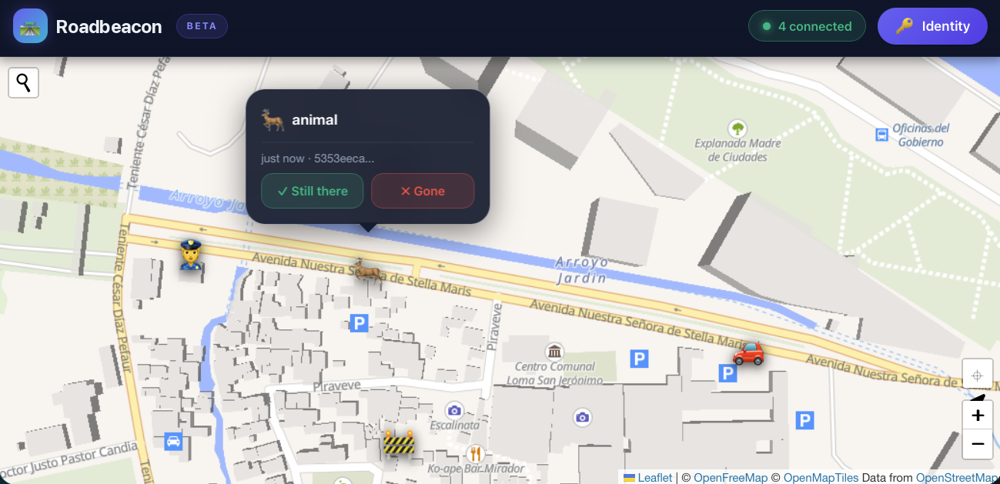
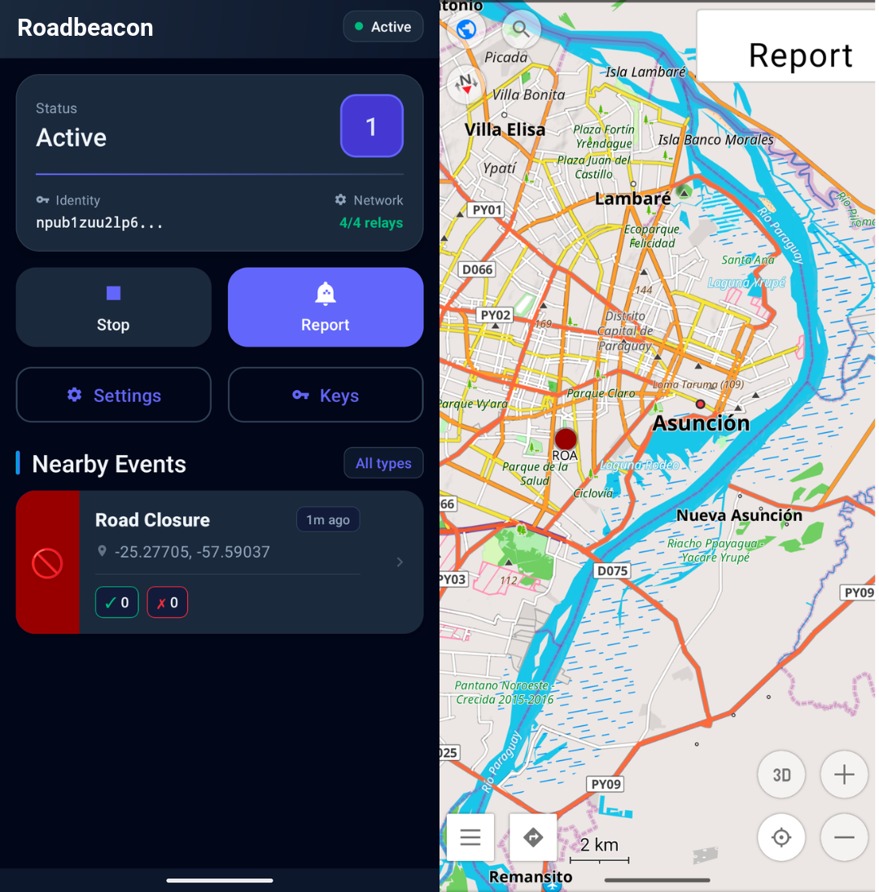

# Roadbeacon

**A decentralized road event reporting system — "Waze without the centralized tracking"**

<!-- jooray-links:start -->
### More from me

**Related projects**

- [MeshCore-BTC](https://github.com/jooray/MeshCore-BTC): Bitcoin price bot for MeshCore mesh networks
- [MeshCore-BitChat](https://github.com/jooray/MeshCore-BitChat): bridge between MeshCore and BitChat mesh networks
- [nostr-scripts](https://github.com/jooray/nostr-scripts): small Nostr command-line scripts

**Full project showcase:** [Roadbeacon in my project showcase](https://juraj.bednar.io/showcase/#RF-03), or [all my projects](https://juraj.bednar.io/showcase/).

I write about building things on [my blog](https://juraj.bednar.io/en/blog-en/). I also wrote a cypherpunk novel, [Tamers of Entropy](https://tamersofentropy.net/), and there is a [trailer](https://tamersofentropy.net/#trailer).
<!-- jooray-links:end -->

Roadbeacon lets drivers report and view road events (police, accidents, construction, hazards) using the Nostr protocol. Events are cryptographically signed, verifiable, and shared across a decentralized network of relays. No central authority, no tracking, no data harvesting.

Formerly called Roadstr. The app was renamed to avoid confusion with the independent
[Roadstr navigation app](https://github.com/roadstrapp/roadstr-app), and 0.4.0 adopted that app's
event layout so both clients write the same bytes. See [`docs/ecosystem.md`](docs/ecosystem.md) for
the whole story and the plan for the two apps.

### [Web Version](https://cypherpunk.today/static/roadstr)



### Android Version — [Install from Zapstore](https://zapstore.dev/apps/app.roadbeacon)



Left: Android app, Right: OsmAnd integration showing events and Report button

## Features

- **Decentralized**: Events published to Nostr relays, no central server
- **Verifiable**: All events cryptographically signed with secp256k1 Schnorr signatures
- **Privacy-aware**: Use persistent identity or ephemeral keys per event
- **Mesh-ready**: Compact binary format (117–165 bytes for a report, 134 for a vote) designed for MeshCore transport, with a strict encoder that refuses anything that cannot be rebuilt byte for byte
- **Android + Web**: OsmAnd plugin for in-car navigation, browser interface for browsing

### Event Types

Police, police stations, speed cameras, surveillance cameras, traffic jams, accidents, road closures, construction, hazards, road conditions, potholes, fog, ice, animals, and custom events.

### Confirmation System

Drivers can confirm ("still there") or deny ("no longer there") existing reports. Events automatically expire based on type (1 hour for traffic jams, 30 days for speed cameras, etc.).

## How It Works

Events are published as Nostr events (kind 1315 for reports, 1316 for confirmations) with geohash tags for efficient spatial querying. The protocol is designed to work both over internet (Nostr relays) and off-grid mesh networks (MeshCore). Mesh nodes can bridge between networks, allowing internet-connected users to publish events received via mesh, and vice versa.

0.4.0 writes the same event layout as the independent [Roadstr navigation app](https://github.com/roadstrapp/roadstr-app): `lat, lon, g, g, g, t, expiration[, maxspeed]` with six-decimal coordinates, no `alt`, and two-tag votes (`e, status`). The previous layout is deprecated and no longer read or written.

## Platforms

### Web

Zero-build vanilla JavaScript interface with Leaflet maps, using OpenFreeMap vector tiles by default and automatic raster fallback during map startup failures. View events, report new ones, and confirm/deny existing reports. Works with NIP-07 browser extensions (Alby, nos2x) or generates ephemeral keys.

### Android (OsmAnd Plugin)

Integrates directly with the OsmAnd navigation app via AIDL. Events appear as color-coded markers on your route. Proximity alerts warn you when approaching reports (500m ahead). Report events with a quick-action widget while driving.

## How to Try

**Web version**: [Try it online](https://cypherpunk.today/static/roadstr)

**Android app**: Install from [Zapstore](https://zapstore.dev/apps/app.roadbeacon), or download the APK from [GitHub Releases](https://github.com/jooray/roadbeacon/releases)

(Requires OsmAnd app installed to view)

## The other Roadstr

[Roadstr](https://github.com/roadstrapp/roadstr-app) ([Zapstore](https://zapstore.dev/apps/app.roadstr))
is an independent navigation app for Android by a different author. It is not affiliated with
Roadbeacon, has its own code and roadmap, and the two apps are not interchangeable.

They do share the road-event event format (Nostr kinds 1315/1316) partially: each app can display
the other's reports, with its own category and lifetime rules, and a report only travels over a
MeshCore radio when it is exactly canonical. We like it and we recommend it if you want
turn-by-turn navigation; Roadbeacon is for people who want road events inside OsmAnd and in a
browser.

## Architecture

- **Android**: Kotlin, service-based architecture with foreground service, WebSocket relay connections, geohash-based queries, AIDL integration with OsmAnd
- **Web**: Vanilla JS, no build system, Leaflet maps with configurable OpenFreeMap vector or legacy raster basemaps, nostr-tools
- **Protocol**: Nostr events (NIP-01) with multi-level geohash tags, NIP-40 expiration, compact binary encoding for mesh

Both platforms share the same event format and remain compatible.

## Building

### Android

```bash
cd roadbeacon-android
export JAVA_HOME="/Applications/Android Studio.app/Contents/jbr/Contents/Home"
./gradlew assembleDebug
```

APK output: `app/build/outputs/apk/debug/app-debug.apk`

If the bundled JDK is newer than the Gradle version supports, point `JAVA_HOME` at a JDK 17
(for example one provisioned under `~/.gradle/jdks`).

### Web

No build required. Open `roadbeacon-web/index.html` in a browser. Basemap mode is configured in `roadbeacon-web/js/config.js`: set `MAP_DISPLAY_CONFIG.mode` to `'vector'` (default OpenFreeMap) or `'raster'` (legacy Leaflet raster tiles). In vector mode, change `MAP_DISPLAY_CONFIG.vector.style` or `styleUrl` to switch the OpenFreeMap style source.

## Protocol

Roadbeacon uses two new Nostr event kinds:

- **Kind 1315**: Road event reports (police, accidents, hazards, etc.)
- **Kind 1316**: Confirmations/denials of existing reports

Reports include geohash tags at multiple precision levels (4, 5, 6 characters) for efficient spatial querying; votes are two tags and are fetched by `#e` for the reports in view. The compact binary encoding (117–165 bytes for a report including up to 48 bytes of comment, 134 for a self-contained vote) enables mesh transport while preserving cryptographic verifiability.

See `nips/road-events.md` for the specification. The format is called **Road Events** and carries no brand in any event.

## Documentation

- `docs/ecosystem.md` — the two apps, compatibility, and the path forward (frames, MeshCore, v2)
- `SPECIFICATION.md` — Complete technical specification
- `nips/road-events.md` — Draft NIP for kinds 1315/1316 (ready for submission to nostr-protocol/nips)
- `reference/osmand-aidl.md` — OsmAnd plugin API documentation

## Support and Value4Value

If you like this project, I would appreciate if you contributed time, talent, or treasure.

**Time and talent** can be donated in testing it out, fixing bugs, or submitting pull requests.

**Treasure** can be [donated here](https://juraj.bednar.io/en/support-me/).

## License

[Unlicense](https://unlicense.org/) — Public Domain

## Author

Juraj Bednár
